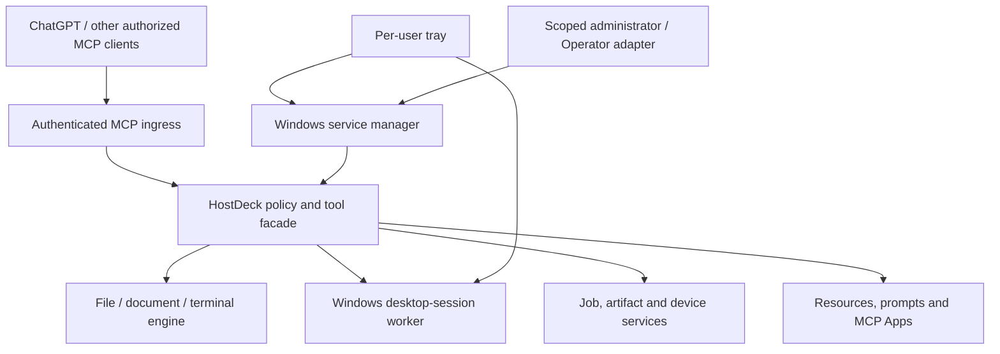

# HostDeck — Product masterplan

**Document status:** implementation baseline, October 2026. **Product status:** pre-release; implementation and acceptance incomplete.

This document is the human-readable source of product intent and acceptance. Operator maintains the executable project graph, task claims, inputs, checkpoints and reviews. Task status never overrides verified code or test evidence.

## 1. Product outcome

HostDeck is one installable, self-hosted Windows control platform for authorized AI and human operators. It exposes a consistent MCP interface for terminal, files, document work, Windows GUI automation, processes, reliable jobs, artifacts and diagnostics. It has one coherent desktop management experience (service, per-user tray, optional local UI), one supported release/update lifecycle and one full-featured ChatGPT plugin.

The product remains useful without ChatGPT and without continuous access to any external control plane. Internal modules may use independent processes and language runtimes, provided the installation, authority, tool semantics, diagnostics and updates stay coherent.

## 2. Fixed decisions

- Source repository: `MaxTomahawk/HostDeck`, **public**. The official product is HostDeck; release commits/tags come from tested `main`. Development uses short-lived feature branches and reviewed merges.
- Follow upstream maintenance branches, tags, fixes and releases as engineering inputs. Do not publish automatic merges or enable scheduled upstream checks until the product is ready.
- Avoid public personal data, hostnames, machine paths, access tokens, credentials, diagnostic dumps, personal configuration or infrastructure topology. Scan current worktrees, commits, history, release artifacts and logs before publication. Required license/copyright notices remain intact.
- GitHub Actions is unavailable due to a quota limit. Use reproducible local/Windows/WSL builds and evidence until a suitable CI executor is actually available. Do not mark Windows tests done on the basis of Linux mocks.
- Reuse safe, tested components from the existing `0.1.0-dev.1` prototype after an inventory, license/provenance, compatibility and security review. It is not yet integrated into the public fork.
- Follow current owner authorization for any write to remote infrastructure, tunnel/DNS settings or production identities. No generic shell or model response constitutes privileged authorization.

## 3. Functional scope

**Core:** discover, read, search, edit, move and inspect files; process structured documents; start and interact with local processes; inspect process status and perform bounded terminal operations; control windows, screenshots, accessibility/UI trees, clipboard, mouse/keyboard and application state only inside an authorized logged-in user session.

**Reliable execution:** persisted job identifiers, idempotency keys, stdout/stderr, exit receipts, lease/reconciliation rules, cancel and timeout, large-output artifact manifests with integrity hashes, multi-device identity and scoped routing, event history and recovery.

**MCP and remote:** current MCP transport compatibility (stdio where appropriate; authenticated Streamable HTTP externally), dynamic but explicitly authorized tools, resources, prompt templates, compatible MCP Apps UI resources, per-identity and per-device authorization, safe connection recovery.

**UX:** reliable Windows service independent of shells/SSH, per-session GUI worker, notification-area controller, PowerShell/SSH service commands, health and diagnostics, accessible web/desktop status UI where justified, startup/restart controls and safe configuration.

**ChatGPT:** one branded plugin with tool namespaces, scoped permissions, Skills with relevant references, MCP prompt templates, ChatGPT-host-compatible interactive resources, sidebar/panels where supported, user-visible status and artifact retrieval.

**Quality of life:** configuration validation, diagnostic bundles without secrets, stable tool contracts, supported upgrade/rollback, clear user/developer/admin docs, agent-readable maintenance instructions and release provenance.

## 4. Architecture and invariants

- Public tool contracts are stable and namespaced; adapters must not reveal unreviewed backend tools or silently bypass risk rules.
- Privilege boundaries are explicit: service runtime vs logged-in UI session vs external administrative authority. A system service cannot act as an interactive Windows desktop user.
- Network ingress initially binds to loopback; remote publication requires correct OAuth issuer, audience/resource, scopes, expiry, replay controls, external identity checks and independent security review.
- The selected ingress is a dedicated outbound Cloudflare Tunnel on the Windows device forwarding to its loopback listener. RatServer supplies architecture/runbook knowledge only, not an ingress intermediary. Configure the actual access policy before publishing a hostname. Operator hands off only concrete human actions available agent tools cannot perform.
- A list of allowed tool names is not a shell sandbox. OS account permissions, path restrictions, process isolation, egress policy and high-impact operation checks are separately enforced.
- Credentials reside only in approved secret stores; never in repo, prompt templates, job metadata, logs, URLs or screenshots.
- HostDeck's runtime is not dependent on a chat window remaining open. Job state and evidence survive client disconnect; interrupted work reports truthful state and is never silently marked successful.
- Updater stages exact, hashed/signed releases, verifies compatibility and health, then atomically switches and retains a rollback path.

## 5. Development and integration method

1. Snapshot current `main` identity, upstream refs, tag versions, branch divergence and relevant licenses. Inspect incoming code without executing it by default. Validate reuse candidates from the old development package against the public fork and choose smallest safe integration deltas.
2. Establish code ownership, API/schema contracts, baseline threat model, public-safe repository hygiene, source-attribution register and reproducible local test commands.
3. Build and verify a narrow MCP facade using real adapter conformance fixtures; integrate functionality incrementally without indiscriminately merging entire dependency histories.
4. Build Windows service, session worker, tray and install/update paths using Windows/WSL. Validate real Windows user and service identities in isolated test configurations.
5. Add durable job journal, scoped artifact retrieval, observability and multi-device reconciliation; validate restart/disconnect/idempotency with injected failures.
6. Integrate UI interaction and privileged-system tools under stable contracts and the device/server authorization model; confirm no remote access to secure-desktop/UAC boundaries.
7. Integrate authenticated remote ingress and bounded administrator actions; test deny-by-default and rollback. Any live tunnel/DNS/identity change requires a separate admissible execution transaction.
8. Build and test ChatGPT plugin, Skills, resources, prompts and UI surfaces with real client tool discovery, permission prompts, authentication and regression cases.
9. Audit public source and release artifacts; run Windows acceptance suite, verify update/rollback, publish a stable release from a tested `main` commit only.

## 6. Concrete phase gates

| Phase | Delivery boundary | Minimum independent exit evidence |
|---|---|---|
| P0 — Reconciliation | Existing public fork and prototype audited | Baseline commit IDs, diff/inventory, provenance, public-leak scan and compatibility decisions |
| P1 — Contracts and safeguards | Stable MCP and authorization design | Schemas, threat model, explicit deny tests, resource/prompt semantics and no privileged bypass |
| P2 — Runtime foundation | Real file/terminal and gateway behavior | MCP inspector/protocol tests against an actual runtime, not only mocks |
| P3 — Windows lifecycle | Service, tray, session worker and package | Fresh Windows install, logon/reboot/crash tests, ACL validation and rollback rehearsal |
| P4 — Product capabilities | GUI, jobs, artifacts, devices, diagnostics | Real Windows end-to-end cases and restart/timeout/cancel test receipts |
| P5 — Remote, Operator and auth | Bound identities, safe ingress and management | 401/403 negative tests, scoped authorization, exact change receipts and independent ingress recovery |
| P6 — ChatGPT integration | Plugin and actual UI/Skill behavior | Real tool discovery, skill invocation, UI/panel checks and end-user scenarios |
| P7 — Release and upkeep | Stable public release | Clean build, reproducible evidence, privacy/secret review, packaged installer, upgrade/rollback and signed/chk artifacts |

Parallel work is permitted if an independent task has no unmet technical prerequisite. No phase is complete solely because a file exists or a script exits zero.

## 7. Governance, quality and acceptance

- **Review:** code tests + functional acceptance + security/quality criteria; failures initiate explicit rework and downstream impact checks.
- **Evidence:** real version/commit identities, reproducible commands, environment and test output, artifact checksums, screenshots only when sanitized, rollback instructions and independent check receipts.
- **Public privacy:** secret scanning of current and historical commits, filenames, binary artifacts and documentation; signed releases and dependency/SBOM inventory before stable publication.
- **Human tasks:** never assign human intervention automatically; propose with agent/tool alternatives and obtain explicit owner acceptance. Human-protected input, MFA and credentials remain in the dedicated secure interface.
- **Inputs:** required nonsecret inputs are typed and separately validated; submitted does not equal accepted.
- **Execution:** agents select genuinely ready tasks in Operator, claim with lease/fence, maintain versioned checkpoints, release unfinished claims and mark Done only against verified acceptance.
- **Separate authorities:** Git/source and test evidence define implementation truth; Operator defines execution/coordination state; live systems define runtime truth. Privileged changes follow their controlling policies.

## 8. Upstream maintenance after product readiness

Store monitored source repositories, relevant branches/tags, last reviewed commit IDs, release/security notices and adapter compatibility matrices in a technical maintenance register. Compare changes to HostDeck's API/contracts and tests, classify relevance and risk, generate an isolated proposed patch/PR, run local Windows/WSL verification and merge only after review. Schedule monitoring only after stable release and explicit activation.

## 9. Current baseline and truthful next actions

- The integrated HostDeck runtime, Windows installer, lifecycle service, desktop/session worker, tray, management UI and plugin source are implemented on the delivery branch. The product is still pre-release.
- Actual HTTP and stdio integration and focused native Windows, document, browser, durable-state and UI checks have passed. These checks do not establish remote or ChatGPT acceptance.
- A real fresh installation has completed and the automatic LocalService service runs. Installed enrollment/session acceptance found a broker-verification and pipe-reconnection issue; fixes and installed acceptance are in progress. Reboot, upgrade/rollback, production OAuth/remote ingress and actual ChatGPT use remain unaccepted.
- The old prototype archive remains unavailable; this blocks only reuse of that archive. The active five work packages and `NEXT_RUN.md` supersede the original granular execution ceremony. Git/GitHub is the content source, Operator tracks execution; Linear synchronization is discontinued.
- Reuse existing evidence, run focused checks for changed behavior and one integrated acceptance pass. Preserve checks against unauthorized effects, wrong sessions, data loss and broken installation. Current status and immediate work are maintained only in `NEXT_RUN.md` and the existing Operator project.

**Definition of complete:** a real Windows user installs and operates HostDeck; correctly authenticated MCP clients and ChatGPT use its coherent tools/UI; long-running operations, policy and remote access behave predictably; updates and recovery work; every accepted task has evidence; and the repository/release reveals no private data.
